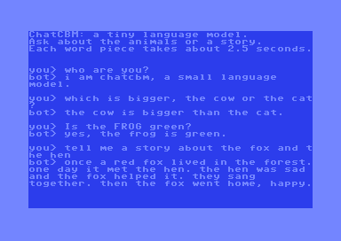

# ChatCBM

A tiny language model that chats on a Commodore 64.

ChatCBM is a project created and maintained by Fabio Carignano: a decoder-only transformer
with 36,416 parameters, written from scratch, trained in Python with NumPy and run in 6502
assembly. On the C64 the model takes 23 KB, the whole program 37 KB, and it produces a token
(a word or a piece of a word) about every 2.5 seconds. Its answers are bit for bit those of
the Python integer engine that specifies it.

It knows a small world: 16 animals with their color, home, food, sound, habits, size and legs.
It answers questions about them (*what does the fox eat?*, *is the pig pink?*, *which is
bigger, the cow or the cat?*, *which animals live in the forest?*), makes small talk and tells
short stories about one or two animals.

## Origins

- The idea comes from the video [Let's build a tiny language model](https://youtu.be/YmLp8qe87A0):
  a transformer small enough to understand, trained on a small controlled world.
- The number format inside the engine is Fabio Carignano's own idea, from his earlier
  experiments on removing multiplications from 3D graphics on the 6502. Values are stored as
  logarithms (log8: a sign and a 7-bit exponent), a product becomes the sum of two exponents
  and a 256-byte table turns it back into a linear value. Here the same idea computes the
  neuron matrices.
- The development was assisted by AI (Claude, by Anthropic): design discussions, code, tests
  and measurements.

## How it fits in 64 KB

- **A small model**: 32-dimensional embeddings, 4 layers, 4 heads, a 32-wide FFN, a 64-token
  context and 256 BPE tokens, so a token is one byte.
- **4-bit weights**: nf4, two per byte, with one scale per neuron (17 KB). Quantization-aware
  training keeps the quality of the float model.
- **No multiplications**: activations in log8, products as table lookups. The matrix kernel
  takes about 30 cycles per product, see [docs/engine.md](docs/engine.md).
- **Integers only**: biases, LayerNorm, softmax, GELU and the sampler use additions, shifts and
  tables.
- **Weight tying**: the embedding matrix also computes the output logits.
- **All the RAM**: while computing, BASIC and KERNAL ROMs and I/O are banked out. The 16 KB KV
  cache sits at $C000-$FFFF, partly under the ROM, and the zero page is shared with the kernal
  by swapping, see [docs/c64.md](docs/c64.md).
- **A cheaper prompt**: the prompt tokens before the last one only fill the KV cache, and the
  first token, always the same, is computed once at start.

## Limits

- It only knows its world: anything else gets a wrong or memorized answer.
- Each question is a turn of its own: there is no memory of the conversation.
- A question and its answer must fit 64 tokens: longer questions are refused.
- Lower-case ASCII only; unknown characters become an unknown token.
- The integer engine is a little less accurate than the float model: 1,153 exact answers out
  of 1,191 against 1,190; for example, *how many legs has the duck?* gets *four legs*.
- It is slow: about 1.5 seconds per prompt token, then 2.5 seconds per answer token, so a
  story takes about two and a half minutes. Fast mode (`/f`) blanks the screen while
  computing and saves about 5%.

## Try it

Load and run `chatcbm.prg` (built in `build/c64/`, or the artifact of the CI) on a C64 or in
VICE: `x64sc -autostartprgmode 1 -autostart build/c64/chatcbm.prg`. Type a question and press
RETURN; `/f` toggles the fast mode, `/q` resets the machine. On a PC, `make chat` talks to
the same integer engine in Python.

Tested in VICE and on a Commodore 64 Ultimate; at its 64 MHz turbo the answers come word by
word, like on a teletype.

## Build and test

Requirements: [cc65](https://cc65.github.io/) 2.19, Python 3 with NumPy, GNU make, and
[VICE](https://vice-emu.sourceforge.io/) for the C64 end-to-end test.

| command | what it does |
|---|---|
| `make` | builds `build/c64/chatcbm.prg` and runs every test except the one in VICE (as the CI does) |
| `make test` | Python tests, a sim65 unit test per 6502 module, and the whole program on sim65 |
| `make e2e` | the C64 program in VICE, answering exactly as the Python engine |
| `make model` | regenerates corpus, tokenizer, training, QAT and integer image (about 10 minutes) |
| `make evaluate` | float32 and integer engine on every fact and on sampled stories |

How the tests work: [docs/testing.md](docs/testing.md). The model and its training:
[docs/model.md](docs/model.md).

## License
Copyright (c) 2026 Fabio Carignano
SPDX-License-Identifier: MIT

See [LICENSE](LICENSE) file for details.
